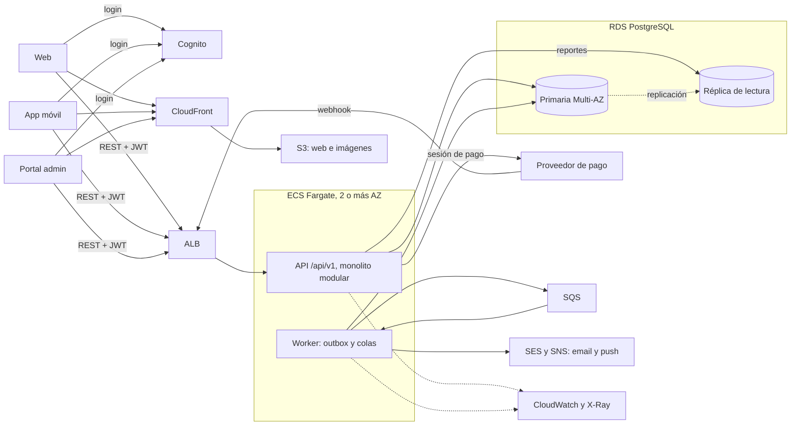

# 2. Caso de arquitectura

Elijo AWS. Asumo un equipo pequeño que conoce Node y PostgreSQL, y un proveedor de pago con página o SDK propios para la tarjeta, que acepta idempotency keys y envía webhooks firmados.

## 13. Arquitectura

Todo vive en una región, repartido en al menos dos zonas de disponibilidad.

## 14. Flujo de pago

1. Al presionar "Pagar", la app envía `POST /api/v1/orders` con el carrito y un `Idempotency-Key` que se repite en cada reintento.
2. En una sola transacción, la API registra la key, crea la orden como pendiente de pago, descuenta el stock y deja una reserva de 15 minutos. Si falta stock, responde 409.
3. Fuera de la transacción, pide al proveedor una sesión de pago con el id de la orden como idempotency key y devuelve la URL de pago.
4. El usuario paga en la página del proveedor; la tarjeta no pasa por nuestros servidores, lo que reduce el alcance de PCI.
5. Llega el webhook firmado. La API verifica la firma y, en una transacción, descarta el evento si ya lo vio, marca la orden como pagada y guarda el evento en el outbox.
6. Un worker publica el evento en SQS y otro envía el email y el push de confirmación.
7. La app consulta la orden hasta verla pagada.

Si el webhook no llega, el proveedor lo reintenta. Además, un job revisa las reservas vencidas y consulta al proveedor antes de liberarlas: si el pago salió, confirma la orden; si no, la cancela y devuelve el stock.

## 15. Componentes

- Frontend: la web es un build estático en S3 detrás de CloudFront. Web, app móvil y portal admin usan la misma API `/api/v1`.
- Backend: un monolito modular en Node sobre ECS Fargate, detrás de un ALB, con al menos 2 tareas en zonas distintas.
- Autenticación: Cognito con roles de cliente, tienda y admin. La API valida el JWT y aplica el rol en cada endpoint.
- Datos: PostgreSQL en RDS Multi-AZ, porque stock, órdenes y pagos necesitan transacciones. Una réplica atiende los reportes.
- Caché: CloudFront para estáticos e imágenes. Redis lo agregaría para el catálogo solo si las métricas lo piden.
- Mensajería: SQS con patrón outbox: el evento se guarda en la misma transacción que el cambio, así que no se pierde.
- Imágenes: S3 privado servido por CloudFront.
- Observabilidad: logs, métricas y trazas con OpenTelemetry hacia CloudWatch y X-Ray, con alarmas sobre errores y latencia del checkout. Secretos en Secrets Manager; CI/CD y rollback en el punto 6.

## 16. Consistencia

Fuerte, en la base principal y en transacciones:

- Stock y reservas.
- Órdenes y sus cambios de estado.
- Pagos, idempotency keys y webhooks procesados.
- Auditoría, escrita en la misma transacción que la acción, para que nada quede sin rastro.

Eventual:

- Notificaciones.
- Web e imágenes servidas por CloudFront.
- Reportes en la réplica de lectura.
- Búsqueda, si algún día va en un motor aparte.

## 17. Overselling y duplicados

Overselling: el stock se descuenta con un `UPDATE ... WHERE available >= qty` en la misma transacción que crea la orden. Si dos clientes compran la última unidad a la vez, la base los procesa uno tras otro y al segundo ya no le alcanza: su orden se rechaza. Si el usuario no paga, la reserva vence y la unidad vuelve.

Cobros duplicados: el `Idempotency-Key` hace que un doble clic o un reintento devuelva la misma orden. Hacia el proveedor uso el id de la orden como idempotency key, y la base permite una sola sesión de pago por orden, así que un reintento tras un timeout no abre un segundo cobro.

Webhooks duplicados: verifico la firma y guardo el id de cada evento con un índice único; si ya existe, respondo 200 sin hacer nada. La orden solo avanza de estado, así que un evento viejo no la deshace. Los consumidores de SQS siguen la misma regla, porque SQS también puede entregar dos veces.

## 18. Escalar y recuperarse

Escalar. La API agrega tareas según CPU y requests, y antes de cada campaña subo el mínimo porque una tarea nueva tarda minutos en arrancar. Antes de la primera campaña haría una prueba de carga que simule los 8.000 usuarios concurrentes y los 1.000 rps del pico, para saber cuántas tareas hacen falta. La base escala subiendo el tamaño de la instancia y llevando lecturas a la réplica. Hacia el proveedor uso timeouts y reintentos con backoff para que su lentitud no frene la API.

Recuperarse. 99,9 % son unos 43 minutos de caída al mes. La caída de una zona la cubren RDS Multi-AZ, con failover automático, y las tareas de la otra zona; el objetivo es volver en menos de 30 minutos. Contra borrados o corrupción, RDS permite restaurar a un punto en el tiempo con unos 5 minutos de pérdida como máximo. Cada mes restauro un backup en una instancia aparte para verificarlo. Un despliegue malo se revierte volviendo a la imagen anterior, con migraciones compatibles con la versión previa.

## 19. Monolito modular y qué separar después

Empiezo con un solo servicio dividido en módulos: catálogo, inventario, carrito, órdenes, pagos, notificaciones y auditoría. Cada módulo es dueño de sus tablas y los demás lo usan por su interfaz, sin leer sus tablas. Así se puede separar uno después. El worker corre aparte desde el inicio, para que las notificaciones no afecten a la API. Separaría un módulo solo con una razón medible (escala distinta, equipo propio, despliegue independiente):

- Búsqueda de catálogo, en OpenSearch, si Postgres ya no alcanza.
- Pagos y webhooks, si hay un equipo dedicado o se pide aislarlos.
- Notificaciones, si los canales crecen hasta ser un dominio propio.

## 20. Decisiones técnicas

1. ECS Fargate en vez de EKS. Corre contenedores con autoescalado sin administrar servidores; Kubernetes pide alguien que lo opere y aquí hay solo una API y un worker.
2. RDS PostgreSQL Multi-AZ en vez de una base NoSQL. Stock, órdenes y pagos necesitan transacciones y restricciones únicas, que en DynamoDB exigen más diseño; Aurora también serviría, pero cuesta más y RDS ya cumple el 99,9 %.
3. SQS con outbox en vez de Kafka o EventBridge. Hay pocos eventos y pocos consumidores; Kafka es para volúmenes mucho mayores y caro de operar, y EventBridge rinde con muchos destinos.
4. Cognito en vez de autenticación propia. Da login, recuperación de contraseña, MFA y JWT firmados; hacerlo propio es guardar contraseñas y mantener todo eso.
5. Una región con varias zonas en vez de multirregión. Con 43 minutos de margen al mes, Multi-AZ cubre la falla común; multirregión duplica infraestructura y complica la base, y solo la consideraría con un objetivo de 99,99 %.
