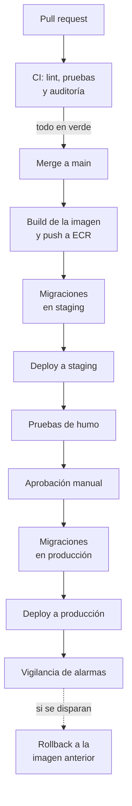

# 6. DevOps y operación

## 33. Pipeline

La misma imagen que pasó por staging es la que llega a producción; no se vuelve a construir. Si un paso falla, el pipeline se detiene ahí.

Lo armaría con GitHub Actions. Es lo básico y alcanza para un equipo pequeño con una API y un worker. No lo elijo por tener el código en GitHub: la herramienta depende de lo que necesite el proyecto. Si la complejidad crece, podría hacer falta Jenkins para CI o Argo CD para los despliegues.

## 34. Dónde corre cada paso

- En cada pull request: lint, pruebas y auditoría de dependencias y vulnerabilidades (`npm audit`). Si alguno falla, no se puede hacer merge.
- Al hacer merge a main: build de la imagen, con el hash del commit como tag, y push a ECR.
- Migraciones: un paso aparte antes de cada deploy (staging y producción), como una tarea puntual de ECS con la imagen nueva. Solo admiten cambios compatibles con la versión anterior del backend, que sigue atendiendo mientras se despliega. Nunca corren al arrancar la app, porque con varias tareas arrancando a la vez competirían por aplicar la misma migración.

## 35. Rollback

El deploy en ECS es por tandas: entran tareas nuevas y salen las viejas a medida que las nuevas pasan los health checks del ALB. Con el circuit breaker de despliegue activado, si las tareas nuevas no logran pasar los health checks, ECS vuelve solo a la versión anterior. Si el problema aparece después (las alarmas se disparan con la versión ya estable), el rollback manual es desplegar otra vez la imagen anterior, con el tag del commit previo, que sigue en ECR. La base no se revierte: las migraciones son compatibles con la versión anterior, así que el código viejo funciona con el esquema nuevo.

## 36. Secretos

Van en AWS Secrets Manager. ECS los inyecta como variables de entorno al arrancar cada tarea, y el rol de ejecución de la tarea solo puede leer los suyos. El pipeline entra a AWS con un rol temporal vía OIDC, así que en GitHub no hay claves guardadas. En el repositorio no hay ningún secreto, ni en archivos `.env`. La contraseña de la base rota automáticamente con Secrets Manager.

## 37. Métricas y alertas del checkout

- Tasa de 5xx en `POST /orders` mayor a 2 % durante 5 minutos.
- Latencia p95 del checkout mayor a 4 s.
- Mensajes en la cola de mensajes fallidos, más de 0.
- CPU o conexiones de la base por encima de 80 %.

Además mediría desde el inicio las fallas al crear la sesión de pago, las órdenes pendientes que vencen sin pago y los webhooks con firma inválida. Sus umbrales los definiría después de las primeras semanas en producción, cuando se vea cómo se comportan el sistema y los usuarios.
